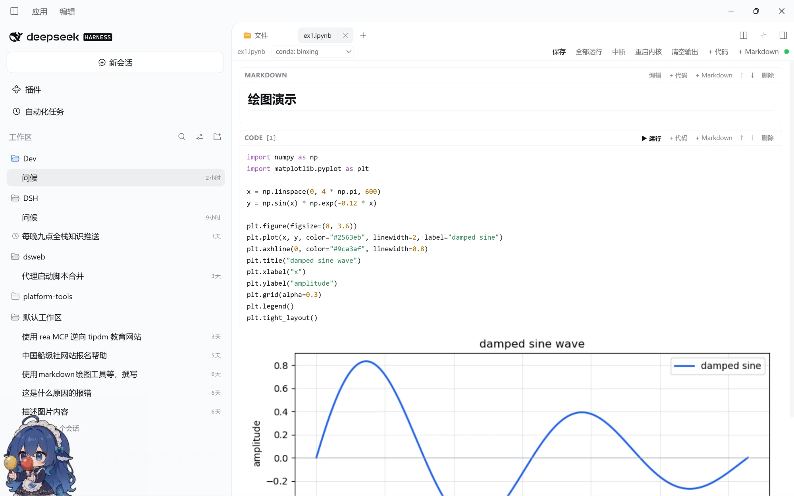

# dsh-jupyter

English | [中文](README.zh.md)

A Jupyter notebook (`.ipynb`) plugin for dsh: open, edit and run notebooks in the Web/Desktop GUI's right sidebar. Rebuilt for the dsh 0.2.x plugin model — plain JavaScript plus one Python script, with no native dependencies and no terminal.

## Demo



## Features

- **Native right-sidebar tab**: clicking a `.ipynb` in the file tree opens it in the same tab system as the text preview. The tab strip, dragging, split view, fullscreen, layout persistence and theme all come from dsh; the plugin only contributes tab types.
- **Text/code file editing**: common source and config extensions (`.py`, `.js`, `.ts`, `.json`, `.yaml`, `.toml`, `.sh`, `.sql`, `.txt`, `.css`, and more) are also handled by this plugin, with editing and saving in the right-sidebar tab. Markdown, HTML, CSV, images, PDF and Office documents stay with the official preview so their richer read-only views are preserved.
- **Cell editing**: code / markdown / raw cells; add, delete and move cells; run all; markdown preview (double-click to edit).
- **Highlighting and indentation**: Python syntax highlighting (keywords, strings, numbers, comments, builtins, decorators, `!` magic lines); Tab / Shift+Tab to indent and dedent; Enter keeps the current indentation and adds a level after `:`.
- **Empty files and recovery**: a 0-byte or whitespace-only `.ipynb` opens as a new notebook; a file that is not valid notebook JSON shows an error with **Reload** / **Open as empty notebook** actions.
- **Real execution**: cells run in a persistent Python kernel in the host process, sharing variables, imports and module state between cells. Output streams as it arrives (stdout/stderr, HTML, Markdown, PNG/JPEG/SVG, JSON, tracebacks), with interrupt and kernel restart.
- **Kernel environment picker**: choose the bundled Python or a conda environment registered in `~/.conda/environments.txt` from the notebook toolbar. Switching restarts the kernel on that interpreter, and the choice is stored in the notebook metadata.
- **Saving**: writes go through dsh's filesystem with its version guard. If the file changed on disk, saving reports a conflict instead of silently overwriting it.
- **Rich output**: pandas `DataFrame` uses `_repr_html_`; PIL images and `_repr_png_` / `_repr_svg_` / `_repr_json_` / `_repr_markdown_` are rendered. matplotlib figures (when installed in that Python environment) are emitted as inline PNGs after the cell.

## Install

From npm:

```sh
dsh plugin --profile web add @kikulmj/dsh-jupyter
```

The Desktop app uses the `desktop` profile:

```sh
dsh plugin --profile desktop add @kikulmj/dsh-jupyter
```

From GitHub (alternative):

```sh
dsh plugin --profile web add github:kikulmj/dsh-jupyter
```

Local development (edit code → `pnpm build` → restart dsh):

```sh
dsh plugin --profile web add link:/path/to/dsh-jupyter
```

- The dsh installer checks `engines.dsh` (this plugin declares `>=0.2.0-0`) and accepts 0.2.x runtimes.
- No pnpm `allowBuilds` and no node-gyp are needed: the plugin has no native modules such as `node-pty`.
- Uninstall: `dsh plugin --profile web remove @kikulmj/dsh-jupyter`.

## Usage

1. Open a project session.
2. Open the right-sidebar file tree (default `Mod+P`) and click any `.ipynb`.
3. The notebook opens as a tab on the right; press `Shift+Enter` to run a code cell and `Ctrl/Cmd+S` to save.
4. Common IPython line syntax is supported: `!command` (for example `!pip list`; `pip` / `python` resolve to the current kernel interpreter), `%pip`, `%cd`, `%pwd`.
5. Clicking a text file such as `.py`, `.json` or `.txt` opens an editable tab; `Ctrl/Cmd+S` saves, with a version-conflict check.
6. Use the **Kernel environment** picker in the notebook toolbar to switch to a conda env (for example `conda: binxing`). `!conda activate` inside a cell only affects that shell subprocess and cannot change the kernel; the picker restarts the kernel on the chosen interpreter and stores the choice in the notebook metadata.
7. Open `examples/plot-demo.ipynb` for a matplotlib demo and a dependency-free SVG fallback.

## Kernel

- Interpreter priority for the bundled choice: `$DSH_PRIMARY_RUNTIME/dependencies/python/…` → `$DSH_HOME/dsh-runtimes/dsh-primary-runtime/dependencies/python/…` → `python3` / `python` on `PATH`.
- Conda environments listed in `~/.conda/environments.txt` (and `~/.anaconda/environments.txt`) appear in the picker. Selecting one runs its `python` directly and sets `PATH` / `CONDA_PREFIX` / `CONDA_DEFAULT_ENV` to approximate `conda activate`.
- The Python 3.12 bundled with Desktop already includes numpy, pandas and Pillow. The kernel bridge uses only the standard library and does not depend on `jupyter_client` or `ipykernel`.
- Python kernels only. A notebook's other kernelspec does not switch languages; it still runs on Python.

## Architecture

```
src/
  index.ts              Host half: /dsh-jupyter/* routes + agent announcement
  core/types.ts         Wire types
  host/scope.ts         Session workspace resolution + filesystem boundary checks
  host/notebook-service.ts  nbformat 4 parse/serialize, reads and writes through ctx.fs (version guard)
  host/routes.ts        read / write / raw / text-read / text-write / execute / interrupt / restart
  host/python.ts        Locate dsh's bundled Python and list conda environments
  host/kernel.ts        One persistent Python kernel process per notebook (JSONL stdio)
  host/kernel_bridge.py Stdlib-only Python kernel bridge (persistent namespace, streaming, interrupt)
  client/index.ts       Register the `.ipynb` and text-file tab types and body slots
  client/panel.tsx      Notebook editor (native slot component)
  client/text-editor.tsx Text/code file editor
  client/code-editor.tsx Transparent textarea + highlight overlay
  client/highlight.ts   Python / JS / C / Shell / SQL tokenizer
  client/api.ts         /dsh-jupyter client
  client/styles.ts      Cell/output/editor styles over dsh's `--dsw-*` theme tokens
```

The browser half only `require`s `react`; the host half imports Node built-ins only. Every dsh service is declared as a peer dependency and provided by the profile at runtime.

## Security

- Every route accepts loopback requests only and checks Host / Origin (the same-origin fence).
- Reads and writes are rooted at the Session's working directory, bounded with `ctx.fs.resolve` + `ctx.fs.contains`, and written through dsh's sandboxed filesystem policy — the workspace limit is never bypassed.
- The kernel runs cell code with the host user's privileges. That is the inherent semantics of a notebook; only run notebooks you trust.

## Limitations

- `input()` / stdin interaction is not supported.
- `!conda activate` only changes that one shell subprocess; it does not change the kernel. Use the toolbar's **Kernel environment** picker instead.
- Inline magics `!`, `%pip`, `%cd` and `%pwd` are supported; `%%` cell magics and other IPython magics (`%time`, `%run`, …) are not.
- `!` commands run with the host user's privileges; output written directly to file descriptors by C extensions or subprocesses is shown once the cell finishes, not streamed live.
- Text editing supports UTF-8 text only, up to 8 MiB per file; binary files still go to the official preview.
- Host-half changes require restarting dsh; client-bundle changes reload through dsh HMR.
- `lib/` is committed, so remote installs need no local build.

## Development

```sh
pnpm install
pnpm build     # tsc → tsdown → copy kernel_bridge.py
```
