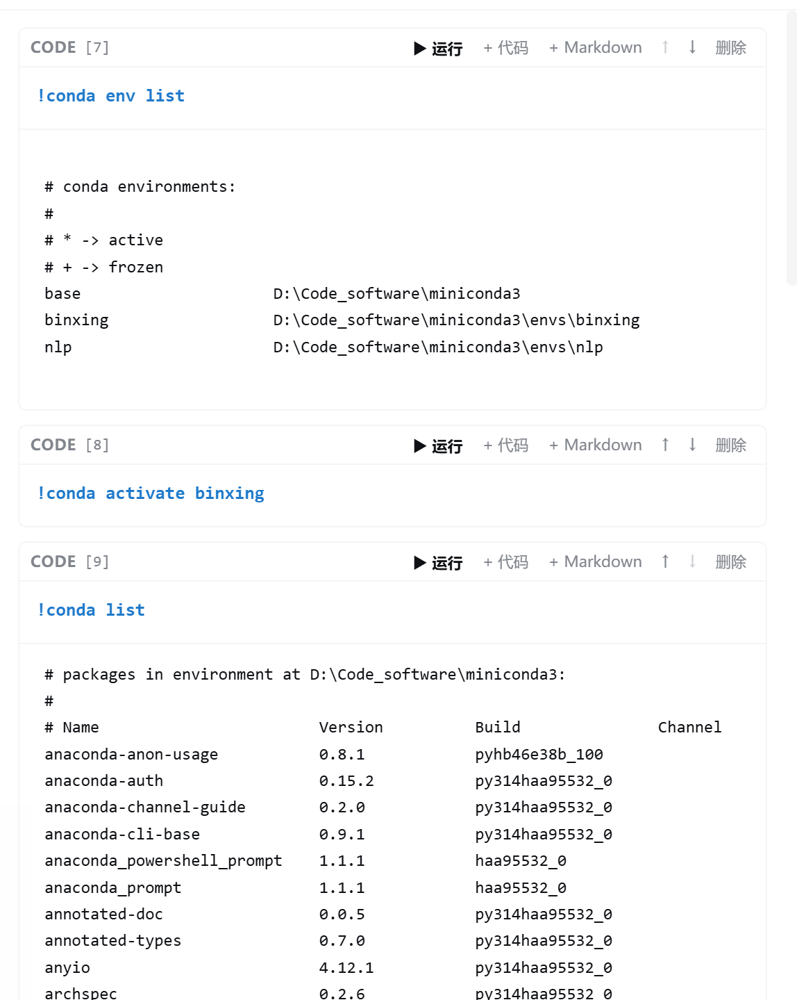

# dsh-jupyter

[English](README.md) | 中文

dsh 的 Jupyter notebook（`.ipynb`）插件：在 Web / Desktop GUI 的右侧边栏里打开、编辑并运行笔记本。按 dsh 0.2.x 的插件模型重写，纯 JavaScript + 一个 Python 脚本，无原生依赖、无终端功能。

## 演示



## 功能

- **原生右侧标签页**：在右侧文件树点击 `.ipynb`，与文本预览共用同一套标签系统。标签条、拖动、分栏、全屏、布局持久化、主题都由 dsh 自己提供，插件只贡献标签类型。
- **文本/代码文件编辑**：常见代码与配置扩展名（`.py`、`.js`、`.ts`、`.json`、`.yaml`、`.toml`、`.sh`、`.sql`、`.txt`、`.css` 等）也由本插件接管，直接在右侧标签页编辑并保存；markdown、HTML、CSV、图片、PDF、Office 等仍交给官方预览，保留其更丰富的只读视图。
- **单元格编辑**：code / markdown / raw 单元格；增删、上下移动、全选运行；markdown 预览（双击回到编辑）。
- **高亮与缩进**：Python 语法高亮（关键字、字符串、数字、注释、内置函数、装饰器、`!` 魔法行）；Tab / Shift+Tab 缩进与反缩进；Enter 保持当前缩进，`:` 结尾自动加一级。
- **空文件与恢复**：0 字节或纯空白的 `.ipynb` 直接按新笔记本打开；文件不是合法 notebook JSON 时显示错误和「重新加载 / 以空笔记本打开」入口。
- **真实执行**：单元格在宿主进程的持久 Python 内核中执行，变量、import、模块状态在单元格之间共享。输出流式渲染（stdout/stderr、HTML、Markdown、PNG/JPEG/SVG、JSON、错误回溯），支持中断与重启内核。
- **保存**：写回磁盘时使用 dsh 文件系统的版本守卫；文件在磁盘上被改动后保存会报冲突，不会静默覆盖。
- **富文本输出**：pandas `DataFrame` 走 `_repr_html_`；PIL 图片和 `_repr_png_` / `_repr_svg_` / `_repr_json_` / `_repr_markdown_` 均可渲染；matplotlib 图（若该 Python 环境已安装）在单元格结束后自动以内联 PNG 输出。

## 安装

远程（GitHub）：

```sh
dsh plugin --profile web add github:kikulmj/dsh-jupyter
```

Desktop 应用使用 `desktop` profile：

```sh
dsh plugin --profile desktop add github:kikulmj/dsh-jupyter
```

本地开发（改代码 → `pnpm build` → 重启 dsh 即生效）：

```sh
dsh plugin --profile web add link:/path/to/dsh-jupyter
```

- 新版 dsh 的安装器会校验 `engines.dsh`（本插件为 `>=0.2.0-0`），与 0.2.x 运行时兼容。
- 不再需要 pnpm 的 `allowBuilds`，也不再需要 node-gyp：插件没有 `node-pty` 之类的原生模块。
- 卸载：`dsh plugin --profile web remove @dsh-local/dsh-jupyter`。

## 使用

1. 进入项目会话。
2. 打开右侧边栏的文件树（默认 `Mod+P`），点击任意 `.ipynb`。
3. 笔记本在右侧以标签页打开；`Shift+Enter` 运行代码单元格，`Ctrl/Cmd+S` 保存。
4. 支持常用 IPython 写法：`!命令`（如 `!pip list`，`pip` / `python` 自动指向当前内核解释器）、`%pip`、`%cd`、`%pwd`。
5. 点击 `.py` / `.json` / `.txt` 等文本文件会打开可编辑标签页；`Ctrl/Cmd+S` 保存，写盘带版本冲突检查。

## 内核

- 解释器优先级：`$DSH_PRIMARY_RUNTIME/dependencies/python/…` → `$DSH_HOME/dsh-runtimes/dsh-primary-runtime/dependencies/python/…` → `PATH` 上的 `python3` / `python`。
- Desktop 自带的 Python 3.12 已包含 numpy / pandas / Pillow 等；内核桥只使用标准库，不依赖 `jupyter_client` / `ipykernel`。
- 仅支持 Python 内核。笔记本声明的其他 kernelspec 不会切换语言，仍以 Python 执行。

## 架构

```
src/
  index.ts              宿主端：注册 /dsh-jupyter/* 路由 + agent 通告
  core/types.ts         wire 类型
  host/scope.ts         Session 工作区解析 + 文件系统边界检查
  host/notebook-service.ts  nbformat 4 解析/序列化，经 ctx.fs 读写（版本守卫）
  host/routes.ts        read / write / raw / text-read / text-write / execute / interrupt / restart
  host/python.ts        定位 dsh 自带 Python
  host/kernel.ts        每个笔记本一个常驻 Python 内核进程（JSONL stdio）
  host/kernel_bridge.py 纯标准库 Python 内核桥（持久命名空间、流式输出、中断）
  client/index.ts       注册 `.ipynb` 与常见文本文件的标签类型和 body slot
  client/panel.tsx      笔记本编辑器（原生 slot 组件）
  client/text-editor.tsx 文本/代码文件编辑器
  client/code-editor.tsx 透明 textarea + 高亮层
  client/highlight.ts   Python / JS / C / Shell / SQL tokenizer
  client/api.ts         /dsh-jupyter 客户端
  client/styles.ts      `--dsw-*` 主题变量下的单元格/输出/编辑器样式
```

浏览器端只 `require("react")`，宿主端只 import Node 内置模块；dsh 服务全部以 peer 依赖声明，运行时由 profile 提供。

## 安全

- 所有路由只接受 loopback 请求，并校验 Host / Origin（同源防线）。
- 读写路径以 Session 的工作目录为根，经 `ctx.fs.resolve` + `ctx.fs.contains` 做边界检查；写入走 dsh 的沙箱文件系统策略，不会绕过工作区限制。
- 内核进程以宿主用户权限运行单元格代码——这是 notebook 的固有语义，请只运行信任的笔记本。

## 限制

- 不支持 `input()` / stdin 交互。
- 支持行内魔法 `!` / `%pip` / `%cd` / `%pwd`；不支持 `%%` 单元格魔法和其余 IPython 魔法（`%time`、`%run` 等）。
- `!` 命令以宿主用户权限执行；C 扩展或子进程直接写到文件描述符的输出会在单元格结束后一次性显示，而非实时流式。
- 文本编辑只支持 UTF-8 文本，单文件上限 8 MiB；二进制文件仍由官方预览处理。
- 宿主端改动需要重启 dsh；客户端 bundle 改动走 dsh 的 HMR。
- `lib/` 已随仓库提交，远端安装无需本机构建。

## 开发

```sh
pnpm install
pnpm build     # tsc → tsdown → 复制 kernel_bridge.py
```
